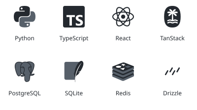
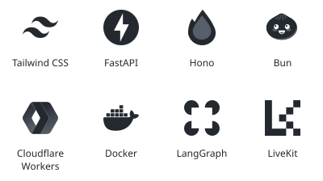

Hi there!

I'm a Systems Eng. student and Software Developer based in Buenos Aires, I like to experiment with new technologies and stuff I come accross on the internet.

Learning everyday and trying to think outside the box!

## Tools I work with

  <picture>
    <source media="(prefers-color-scheme: dark)" srcset="assets/stack-left-dark.svg" />
    
  </picture>
  <picture>
    <source media="(prefers-color-scheme: dark)" srcset="assets/stack-right-dark.svg" />
    
  </picture>

I try to contribute to the great OSS projects that I use on the daily.

  

