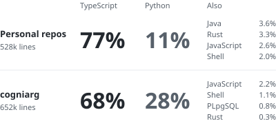

hi there!

i'm Gonzalo, a Systems Eng. student and Software Developer based in Buenos Aires 🇦🇷 

i mostly work with TypeScript and Python, building web-based systems and tools.

i enjoy exploring new technologies, understanding how things work under the hood, and finding simple solutions to complicated problems.

## tools I work with

  <picture>
    <source media="(prefers-color-scheme: dark)" srcset="assets/stack-left-dark.svg" />
    
  </picture>
  <picture>
    <source media="(prefers-color-scheme: dark)" srcset="assets/stack-right-dark.svg?v=0efd1c2653c1" />
    
  </picture>

## languages I mostly use

  <picture>
    <source media="(prefers-color-scheme: dark)" srcset="assets/languages-dark.svg" />
    
  </picture>

share of the lines me and my agents added in the last 12 months.

  

i'm open to new opportunities, contact me at: gonzalozanelli1@gmail.com 📩
